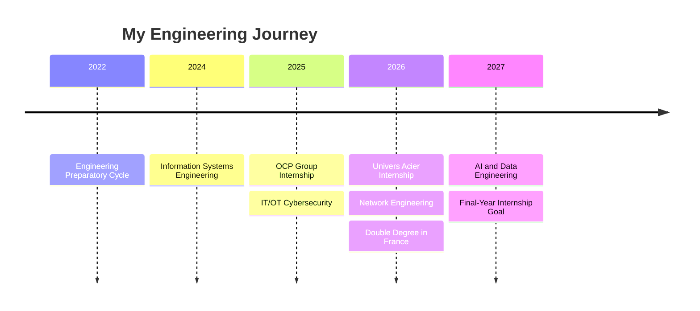

<!-- ANIMATED HEADER -->

<div align="center">


<a href="https://github.com/assia869">

</a>

<br>


</div>

---

## ✦ 01 — Who am I?


```python
class AIEngineer:

    def __init__(self):
        self.name = "Assia Eddaif"
        self.location = "France"
        self.education = [
            "Nantes Université — Master 2",
            "ENSA — Engineering Degree"
        ]
        self.interests = [
            "Generative AI",
            "Data Science",
            "Machine Learning",
            "Intelligent Systems"
        ]
        self.current_goal = "AI Engineering Internship"

    def mindset(self):
        return "Never stop learning."
```

<br clear="both"/>

> Passionate about building intelligent systems that transform complex data into meaningful, real-world solutions.

**Currently seeking a 6-month final-year internship starting March 2027.**

---

## ✦ 02 — My Technology Universe

<div align="center">

### 🧠 Artificial Intelligence & Data Science


<br>


### 🤖 Generative AI & LLMs


### ⚡ Development & Cloud


### 📊 Databases & Analytics


<br>


### 🌐 Software & Security


</div>

---

## ✦ 03 — Selected Projects

<table>
<tr>
<td width="50%" valign="top">

<h3>🤖 ENSAJ AI Assistant</h3>

An intelligent academic assistant using Large Language Models and Retrieval-Augmented Generation.

`Python` `LangChain` `RAG` `Streamlit`

</td>
<td width="50%" valign="top">

<h3>🧠 Local RAG System</h3>

A local document question-answering system powered by open-source language models.

`Ollama` `Gemma 2` `Nomic` `Python`

</td>
</tr>

<tr>
<td width="50%" valign="top">

<h3>🚲 Spatio-Temporal GNN</h3>

Urban mobility forecasting using Graph Neural Networks and temporal learning.

`GCN` `GRU` `PyTorch Geometric`

**82K+ trips analyzed**

</td>
<td width="50%" valign="top">

<h3>🩺 COVID-19 Detection</h3>

Medical image classification with explainable deep learning and visual interpretation.

`CNN` `TensorFlow` `Grad-CAM` `FastAPI`

</td>
</tr>

<tr>
<td width="50%" valign="top">

<h3>💎 Sandokti FinTech</h3>

A financial management application combining mobile development and intelligent analytics.

`Flutter` `Firebase` `ML` `Power BI`

</td>
<td width="50%" valign="top">

<h3>🛡️ SOC & SIEM Lab</h3>

Security monitoring, event analysis and threat detection in a simulated environment.

`Wazuh` `Sysmon` `OpenSearch`

</td>
</tr>
</table>

<div align="center">

<a href="https://github.com/assia869?tab=repositories">

</a>

</div>

---

## ✦ 04 — My Journey



---

## ✦ 05 — Certifications

<div align="center">


</div>

---

## ✦ 06 — GitHub Analytics

<div align="center">


<br>


</div>

---

## ✦ 07 — Contribution Activity

<div align="center">


</div>

---

## ✦ 08 — Let's Connect

<div align="center">

<a href="https://github.com/assia869">

</a>

<br><br>

**Open to opportunities, collaborations and innovative projects.**

<br>

<i>"The best way to predict the future is to build it."</i>

<br><br>


</div>
